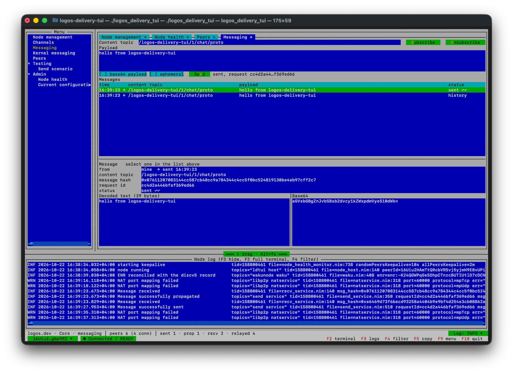
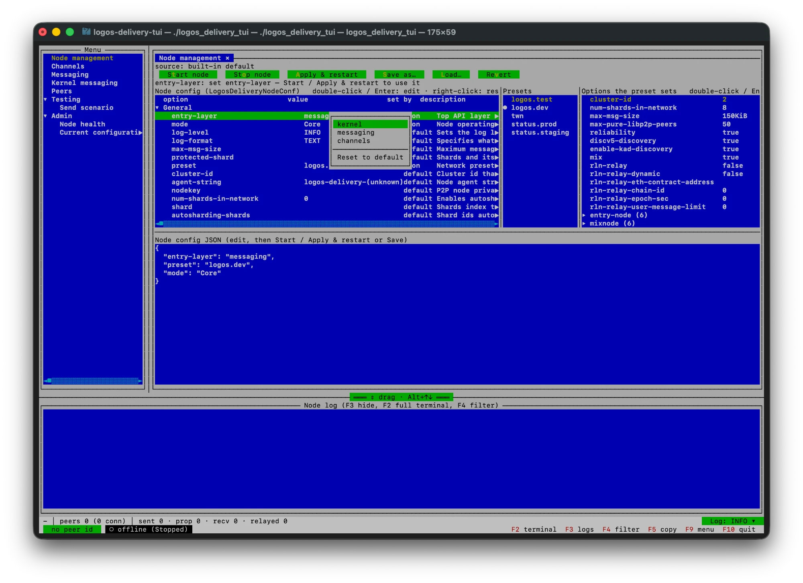
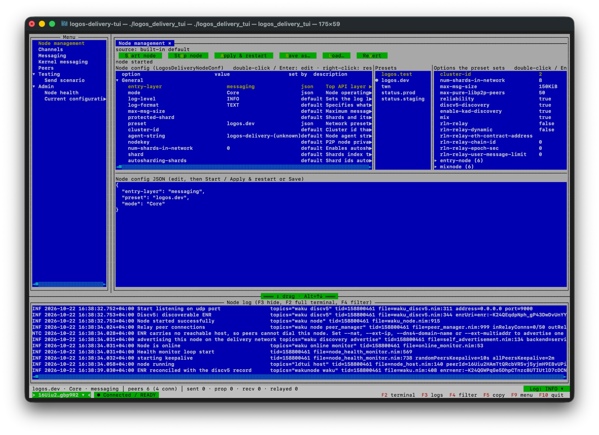
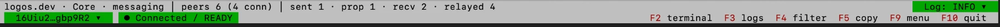

# logos-delivery-tui

A terminal UI and headless scenario runner for one in-process
[logos-delivery](https://github.com/logos-messaging/logos-delivery) node. It is
built for testing, both locally and against the live fleet.



## What it can do

- **Messaging:** subscribe to content topics, then send text or base64
  payloads. Each message is tracked through propagated ✓ / sent ✓✓ / error.
- **Node health:** see connection and protocol health, topic mesh, and peer
  trees by protocol or by peer. You can disconnect peers or dial a multiaddr.
- **Configuration:** edit all of the node's options and presets, with every
  value checked by the node's own config translation. Then start or restart
  the node, and see the effective config it actually runs with.
- **Live node log:** filter it with AND/OR rules on level, message, topics and
  any property, save the filters, or drop into the full terminal.
- **Scenarios:** scripted send, expect and peer steps. Run them in the TUI, or
  headless in CI (the exit code reports PASS or FAIL).

| Configuration | Node running |
|---|---|
|  |  |

The control bar shows the network, peers, message counters, health and log
level:



## Platforms

| | macOS | Linux | Windows | Why |
|---|---|---|---|---|
| `--mm:refc` | ✅ | ✅ | ❌ | logos-delivery is refc-only. illview has no Windows input driver. |
| `--mm:orc` | ❌ | ❌ | ❌ | logos-delivery does not support ORC. |

## Build

Requires Nim `2.2.6` and **Nimble `0.26.0`**, the same versions logos-delivery
pins. Check with `nimble -v`.

```sh
# nimble 0.26.0 (logos-delivery's scripts/install_nimble.sh installs it to ~/.local/nimble-0.26.0)
export PATH=$HOME/.local/nimble-0.26.0/bin:$PATH

nimble setup --localdeps -y    # deps from nimble.lock into ./nimbledeps
nimble buildNativeDeps         # miniupnpc, libnatpmp, bearssl, leopard cmake stubs
nimble build                   # -> ./build/logos_delivery_tui
nimble test                    # unit tests
```

## Run

```sh
nimble tui                                                    # build + run with conf/logos-dev.json
./build/logos_delivery_tui --node-conf=conf/logos-test.json   # TUI, node autostarts
./build/logos_delivery_tui                                    # TUI, config view, node stopped
./build/logos_delivery_tui --node-conf=conf/logos-test.json --scenario=conf/scenarios/ping.json
./build/logos_delivery_tui --headless --scenario=conf/scenarios/ping.json --report=ping.jsonl
```

| Option | Meaning |
|---|---|
| `--node-conf=<file>` | Node config JSON (same format as `liblogosdelivery`'s `create_node`). |
| `--scenario=<file>` | Scenario to load (TUI) or run (headless). |
| `--headless` | No TUI. Logs go to the terminal. Exit code 0 means PASS, 1 FAIL, 2 bad input, 130 interrupted. Without a scenario, the node runs until Ctrl-C. |
| `--log-level=<lvl>` | `TRACE` / `DEBUG` / `INFO` / `NOTICE` / `WARN` / `ERROR`. Overrides the config and survives restarts. |
| `--log-file=<path>` | Also append node logs to a file. |
| `--report=<path>` | Headless only: scenario progress as JSON lines. |
| `--autostart=false` | Do not start the node at launch. |

In the TUI: **F2** terminal · **F3** logs · **F4** log filter · **F9** menu ·
**F10** quit.

## Documentation

- [User guide](docs/USER_GUIDE.md): key combinations, views, configuration,
  log view and filtering, scenario format.
- [Design](docs/DESIGN.md): architecture, decisions, dependency pinning.
