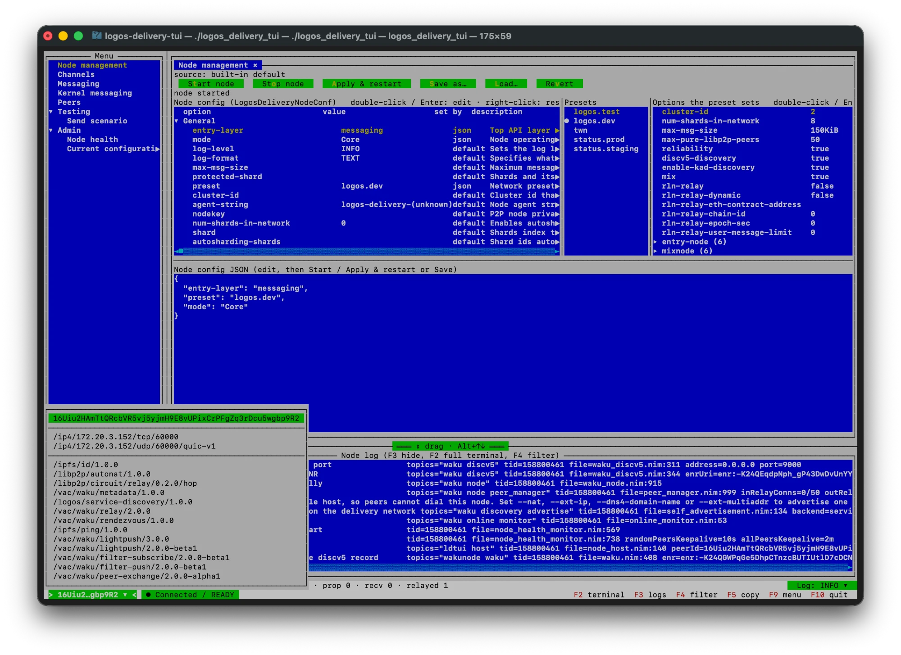

# logos-delivery-tui — User guide

- [Key combinations](#key-combinations)
- [Views](#views)
- [Configuration](#configuration)
- [Control bar](#control-bar)
- [Log view and filtering](#log-view-and-filtering)
- [Scenarios](#scenarios)
- [Build notes](#build-notes)

## Key combinations

### Global

| Key | Action |
|---|---|
| F2 | Terminal mode: the captured log is replayed into the shell scrollback and then streams live. **Enter** returns to the TUI. |
| F3 | Show or hide the bottom log pane (shown at start). |
| F4 | Open the log filter dialog. |
| Shift+F4 | Switch the log filter off or on, keeping its rules. |
| F9 | Show or hide the sidebar. Its width follows the divider on its right (drag it). |
| F10 | Quit. The node is stopped cleanly. |
| Tab / Shift-Tab | Move focus. |
| Ctrl+PgUp / Ctrl+PgDn | Switch tabs (view tabs, and the peer-tree tabs in Node health). |
| Alt+letter | Activate the button with that underlined letter. |
| Click / Enter on a sidebar entry | Open that view as a tab, or focus it if already open. Arrow keys only move the selection. |

### In lists, trees and text panes

| Key | Action |
|---|---|
| Shift+← / Shift+→, Shift+Home / Shift+End, Shift+wheel | Scroll long rows sideways. |
| Ctrl+A | Select all text (log pane, read-only text). |
| F5 or Ctrl+Insert | Copy the selection. |
| End | Log pane: jump to the bottom and follow new lines. |
| Alt+↑ / Alt+↓ on a focused divider | Resize the panes (or drag the divider with the mouse). |

### In the configuration editor

| Key | Action |
|---|---|
| Double-click / Enter on an option | Edit it: a bool toggles, a choice pops a menu, anything else opens an input box. |
| Right-click on an option | Edit… / Reset to default. |
| Double-click / Enter on a preset | Make it the `preset`. |
| Double-click / Enter on a preset option | Put that value into the JSON (a list item is appended). |

## Views

The sidebar (F9) lists the views. Each opens as a tab.

### Messaging


- A content topic field with **Subscribe** and **Unsubscribe**.
- A payload editor. The payload is sent as text, or decoded first if
  **base64 payload** is ticked. **ephemeral** sends an ephemeral message.
- A chat table that tracks each sent message through propagated ✓ / sent ✓✓
  (store-confirmed) / error, and lists received messages as live or history.
  Your own message coming back on the subscription is not listed again. Text
  with newlines is shown with ⏎; payloads that are not text show as hex.
- Under the table (drag the divider to resize) is the selected message in
  detail: from (`mine` or `other party`), direction and time, content topic,
  message hash, request id (yours only), status, and side by side the decoded
  text (all lines) and the payload as base64. A new message selects itself;
  click a row to see another.

### Admin → Node health

Connection status, node health, protocol health and subscribed topics with
their mesh and health. Connected peers are shown as two trees in tabs:

- **By protocol:** protocol → peer → addresses.
- **By peer:** peer → protocols / addresses.

Peer ids are shortened. Expanded branches and the selection survive the 3 s
refresh. From here you can disconnect the selected peer (select the peer row or
any row under it), drop all peers or dial a multiaddr.

### Admin → Current configuration

View only. Shows the running node, or the last one started, with a status line
saying which:

- **Effective configuration:** what the node built at start and runs with, read
  from the node itself. Each row has a **source**: `config` (the JSON),
  `preset`, `default`, or `runtime` (changed by the running node, such as a
  bound port). Secrets are shown as `<hidden>`.
- **Preset in use:** the options of the preset the node applied. A `cluster-id`
  of 1 or 2 selects twn / logos.dev, as logos-delivery does. The pane is hidden
  when no preset was applied.
- **Below:** the exact JSON the node was started from, and its kind
  (`LogosDeliveryConf` or `LogosDeliveryNodeConf`).

It changes only when a node starts successfully. Edit and start nodes in
[Node management](#node-management).

### Node management

See [Configuration](#configuration).

### Testing → Send scenario

Edit, load, save and run a [scenario](#scenarios), and watch its progress.

### Channels, Kernel messaging, Peers

Placeholders, to be specified.

## Configuration

### `--node-conf` files

`--node-conf` takes the same JSON as `liblogosdelivery`'s `create_node` and
delivery-module's `createNode`: either the layered form (`entryLayer`, `mode`,
`preset`, `kernelConf`, `messagingOverrides`, `channelsOverrides`) or the
legacy flat `WakuNodeConf` form. Examples are in [`conf/`](../conf).

Without `--node-conf` the TUI opens Node management with a built-in default and
the node stopped.

### Node management


The app opens on this view. It edits the node config as a
`LogosDeliveryNodeConf`: the logosdeliverynode command line written as flat
JSON with the CLI option names (`entry-layer`, `mode`, `reliability`,
`anonymity-level` and every kernel option). **Start node** / **Apply &
restart** build the node with `LogosDelivery.new(LogosDeliveryNodeConf)`.
**Save as…**, **Load…** and **Revert** manage the JSON.

A config in a `LogosDeliveryConf` shape (a `--node-conf` file, Load…, Revert)
is converted when shown:

| From | To |
|---|---|
| layered | `entry-layer` (default `channels`), `preset`, `mode`; `messagingOverrides` keys lifted to the top level |
| kernel entry layer | `entry-layer: kernel`; `kernelConf` keys lifted |
| legacy flat / preset + mode only | kept, with `entry-layer: channels` |

What has no `LogosDeliveryNodeConf` option (`channelsOverrides`, the
messaging-only rate-limit / send-queue / backfill keys) is listed in the status
line.

- **Left: every option** (107), grouped (General, Messaging, Relay, Discovery,
  Store, …), as option │ value │ set by (`json` / `default`) │ description. The
  list comes from the conf types, so it follows logos-delivery. Lists are
  entered comma-separated; empty input resets to the default.
- **Right: the presets**, and the options the selected one sets.
- **Below:** the JSON itself, editable directly.

Every edit is checked with the node's own translation (the same steps
`LogosDelivery.new` runs) before the JSON changes; a rejected value leaves it
alone.

### Saved files

Bare names given to a save dialog go under `~/.config/logos-delivery-tui/`. A
name containing a path separator or starting with `.` is used as a path.

| Kind | Directory |
|---|---|
| Node configs | `~/.config/logos-delivery-tui/nodes/` |
| Scenarios | `~/.config/logos-delivery-tui/scenarios/` |
| Log filters | `~/.config/logos-delivery-tui/logfilters/` |

## Control bar


- **Line 1, left:** the network, mode and mounted layer, such as
  `logos.dev · Core · messaging`. The network is the preset in use, or
  `cluster <id>` without one. The mode (Core / Edge) is left out for the kernel
  layer, which has none. The layer is what the running node actually mounted.
  Then the peer store size with the number of connected peers, and the message
  counters.
- **Line 1, right:** the log-level selector. A level chosen here or with
  `--log-level` survives restarts.
- **Line 2, left:** this node's short peer id as a button, and the health
  block, coloured by connection status: green Connected, yellow
  PartiallyConnected, red Disconnected, black when the node is not running.
- **Line 2, right:** the hotkeys.

The peer id menu lists the full peer id, the announced multiaddrs and the
mounted protocols:



| Counter | Event |
|---|---|
| sent | `MessageSentEvent` |
| prop | `MessagePropagatedEvent` |
| recv | `MessageReceivedEvent` |
| relayed | `MessageSeenEvent` (all relay traffic on our shards) |
| err | `MessageErrorEvent` |

## Log view and filtering

The node's stdout and stderr are captured into the log pane at the bottom.

- **F3** hides or shows it. Drag the divider above it, or focus the divider and
  press Alt+↑ / Alt+↓, to resize it.
- The pane keeps the last 5000 lines. **End** follows new lines; scrolling up
  stops following.
- **F2** leaves the TUI for terminal mode: the whole captured log is replayed
  into the real terminal scrollback (so the terminal's own search and copy
  work), then streams live. **Enter** returns.
- The level selector in the control bar sets the node's runtime log level.
- `--log-file=<path>` also appends the node log to a file.

### Filters

**F4** opens the filter dialog. Filtering only affects the pane: terminal mode
and `--log-file` always get every line.

A filter is a list of rules. Each rule is `[AND|OR] field operator value`:

| Field | Matches against |
|---|---|
| `level` | The record level (`TRC` `DBG` `INF` `NTC` `WRN` `ERR` `FAT`; `warn`, `W`, … are accepted). |
| `msg` | The message text. |
| `topics` | The `topics=` property. |
| `file` | The `file=` property (`file.nim:line`). |
| `tid` | The `tid=` property (thread id). |
| `key:` | Any property, named in the key box (e.g. `peerId`, `requestId`). |
| `line` | The whole raw line. |

| Operator | Meaning |
|---|---|
| `contains` / `!contains` | Substring. |
| `=` / `≠` | Whole value. |
| `≥` / `≤` | Level only: at least / at most. |

- Text comparisons ignore case.
- **AND binds tighter than OR.** The rules split at every OR into groups, and a
  line passes when every rule of some group matches.
- A rule on a property the record lacks does not match (except `!contains`,
  which does).
- Lines that are not a record start (stack traces, wrapped values) follow the
  verdict of the record above them.
- The dialog shows how many of the kept lines the filter would pass. The pane
  title shows the active filter and `shown/kept` counts.
- **Saved:** filters can be saved by name, loaded and deleted from the dialog.
- **Shift+F4** switches the filter off and on without losing the rules.

Example: warnings and errors except NAT noise, plus everything from the send
service:

```
level ≥ WRN  AND  msg !contains NAT  OR  topics contains send service
```

## Scenarios

A scenario is a JSON list of steps, run in the TUI (Testing → Send scenario) or
headless:

```sh
./build/logos_delivery_tui --headless --scenario=conf/scenarios/ping.json --report=ping.jsonl
```

Headless exit codes: 0 PASS, 1 FAIL, 2 bad input, 130 interrupted. `--report`
writes progress as JSON lines.

```json
{
  "name": "ping",
  "nodeConf": "../logos-test.json",
  "startNode": true,
  "steps": [
    { "action": "waitHealthy", "status": "PartiallyConnected", "timeoutS": 90 },
    { "action": "subscribe", "contentTopic": "/logos-delivery-tui/1/ping/proto" },
    { "action": "sendPeriodic", "contentTopic": "/logos-delivery-tui/1/ping/proto",
      "payload": "ping #{seq} from {peerId}", "intervalMs": 2000, "count": 5 },
    { "action": "sleep", "ms": 11000 },
    { "action": "expect", "metric": "sent", "op": ">=", "value": 5, "timeoutS": 30 }
  ]
}
```

`nodeConf` is optional and resolved relative to the scenario file.
`startNode` defaults to `true`.

| Action | Parameters |
|---|---|
| `waitHealthy` | `status` (`Connected` (default) or `PartiallyConnected`), `timeoutS` (60) |
| `subscribe` / `unsubscribe` | `contentTopic` |
| `send` | `contentTopic`, `payload` (text with placeholders) or `payloadBase64`, `ephemeral` |
| `sendPeriodic` | Same as `send`, plus `intervalMs`, `count` (0 = until the scenario ends) and `jitterMs`. It runs in the background. |
| `sleep` | `ms` |
| `disconnectPeer` | `peerId` |
| `disconnectAllPeers` | — |
| `dialPeer` | `multiaddr` |
| `stopNode` / `startNode` | — |
| `restartNode` | `nodeConf` (optional, relative to the scenario) |
| `setLogLevel` | `level` |
| `expect` | `metric` (`sent` / `propagated` / `received` / `seen` / `errors` / `peers`), `op` (`>=` `>` `<=` `<` `==` `!=`), `value`, `timeoutS` (0 = check once) |
| `log` | `msg` |

Payload placeholders are `{seq}`, `{peerId}`, `{ts}` and `{rand:N}`.

Only this process's node and its connections can be manipulated. Killing other
fleet or harness nodes is out of scope.

## Build notes

- The task is named `tui` because nimble's built-in `nimble run` shadows a task
  called `run`. The built-in works too: `nimble run logos_delivery_tui <args>`
  builds the binary and runs it with exactly the arguments given, with no
  default config.
- RLN is off by default (`-d:disable_rln`). To build with RLN, pass `-d:rln`
  and point `LIBRLN_FILE` at a `librln_v2.0.2.a` (logos-delivery `make librln`
  builds one).
- Older nimbles (e.g. 0.20.x) cannot use `nimble.lock`: they fail with
  `Downloaded package checksum does not correspond to that in the lock file`
  for `nim`, then with `Failed to get VCS revision` or git tag fetch errors.
- Regenerating the lock after a pin bump: [DESIGN.md](DESIGN.md#regenerating-nimblelock).
